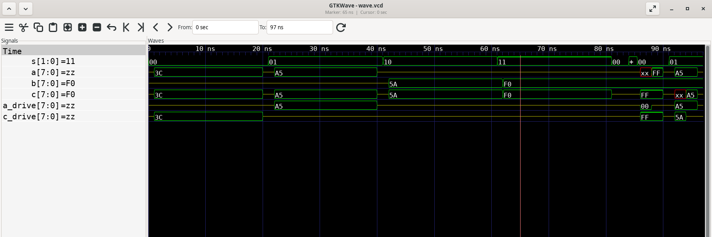
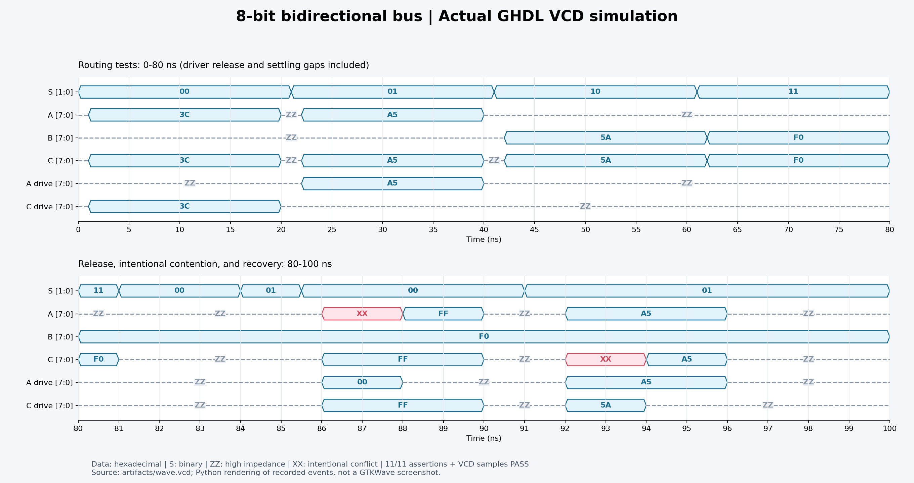

# VHDL 实验一——8 位双向数据总线功能仿真

日期：2026-10-23（Asia/Shanghai）。仓库：`handFOOLed/VHDL-Lab`，任务分支：`work`。原始设计基线：`caf409f`。

## 1. 实验目的

使用 Linux 下 GHDL 的真实仿真验证 8 位双向总线四种传输状态，理解 `inout`、三态释放及多驱动信号解析，完成自动断言、VCD 波形、可视化与结果归档。

## 2. 双向总线工作原理

`std_logic_vector` 的每一位采用 `std_logic` 解析规则。未使用的驱动必须输出 `Z`：有效数据与 `Z` 解析后仍为有效数据；两个驱动分别输出强 `0` 和强 `1` 时解析为 `X`。

| S（二进制） | 数据流向 | DUT 对 A 的驱动 | DUT 对 C 的驱动 |
| --- | --- | --- | --- |
| 00 | C → A | C | Z |
| 01 | A → C | Z | A |
| 10 | B → C | Z | B |
| 11 | B → C | Z | B |

S 是二位选择信号，表中的数据均为 8 位十六进制。`ZZ` 表示八位全高阻，`XX` 表示八位全冲突未知值。

## 3. VHDL 设计说明

检查原文件 `bus_trans.vhd`：实体名为 `bus_trans`；A、C 为 8 位 `inout`，B 为 8 位 `in`，S 为 2 位 `in`。两个并发条件赋值分别控制 A 和 C，对应上述真值表。GHDL 分析、展开成功，未发现本实验四个合法选择状态下的语法或逻辑缺陷，原文件完整保留、未修改。

设计是组合逻辑，没有时钟与人为传播延迟。仿真中的 1 ns 等待用于驱动交接和稳定检查，并不代表器件真实延迟。此设计本身不提供总线仲裁或冲突保护，外部电路必须遵守驱动方向。

## 4. Testbench 测试方案

独立文件 `tb_bus_trans.vhd` 实例化 DUT，使用 `a_drive`、`c_drive` 分别作为 A/C 的外部驱动；初始均为 Z。正常方向切换先释放外部驱动，等待 1 ns，切换 S，再等待 1 ns 后施加输入，稳定后执行断言。正常四组测试中不同时驱动同一总线。

| 名义区间 | S | 真实稳定输入与时间 | 断言采样点 | 预期输出 |
| --- | --- | --- | --- | --- |
| 0–20 ns | 00 | 1 ns 起 C=3C | 5 ns | A=3C |
| 20–40 ns | 01 | 21 ns 切 S，22 ns 起 A=A5 | 25 ns | C=A5 |
| 40–60 ns | 10 | 41 ns 切 S，42 ns 起 B=5A | 45 ns | C=5A |
| 60–80 ns | 11 | 61 ns 切 S，62 ns 起 B=F0 | 65 ns | C=F0 |

20–22 ns、40–42 ns 等短暂释放/稳定区间是有意安排，实际边界如 VCD 所示。B 在首次使用前为 Z，非选中输入不参与该阶段传输。80 ns 后继续执行高阻态、冲突及恢复检查，100 ns 调用 `std.env.finish` 正常退出。

自动验证分两层：VHDL `assert` 检查仿真当时的总线值（失败为 severity failure）；Python 独立解析 `wave.vcd` 的 timescale、信号层级与实际事件，在指定时刻采样，并与预期和实际 PASS 日志共同核对。表中实际值来自 VCD，未用预期数据生成波形。

## 5. 各状态输入与实际输出对照表

以下结果来自本次实际运行的 `results.csv`；预期输出见上一节。

| 采样/ns | S | 外部 A 驱动 | B | 外部 C 驱动 | 实际 A | 实际 C | 结果 |
| --- | --- | --- | --- | --- | --- | --- | --- |
| 5 | 00 | ZZ | ZZ | 3C | 3C | 3C | PASS |
| 25 | 01 | A5 | ZZ | ZZ | A5 | A5 | PASS |
| 45 | 10 | ZZ | 5A | ZZ | ZZ | 5A | PASS |
| 65 | 11 | ZZ | F0 | ZZ | ZZ | F0 | PASS |

四组传输断言均实际执行并通过，正常阶段总线没有 X。

## 6. 高阻态和总线冲突分析

| 检查 | 采样/ns | S | 外部 A 驱动 | 外部 C 驱动 | 实际 A | 实际 C | 结果 |
| --- | --- | --- | --- | --- | --- | --- | --- |
| release_00 | 83 | 00 | ZZ | ZZ | ZZ | ZZ | PASS |
| release_01 | 85 | 01 | ZZ | ZZ | ZZ | ZZ | PASS |
| conflict_00 | 87 | 00 | 00 | FF | XX | FF | PASS |
| recovery_00 | 89 | 00 | ZZ | FF | FF | FF | PASS |
| conflict_01 | 93 | 01 | A5 | 5A | A5 | XX | PASS |
| recovery_01 | 95 | 01 | A5 | ZZ | A5 | A5 | PASS |
| release_final | 97 | 01 | ZZ | ZZ | ZZ | ZZ | PASS |

- 高阻态：S=00 或 01、两侧外部驱动均为 Z 时，A/C 最终都为 Z；S=10/11 时 A 为 Z、C 由 B 驱动。
- 86–88 ns 故意制造冲突：S=00，C 外部驱动 FF，A 外部驱动 00，而 DUT 同时向 A 驱动 FF，因此 A=XX，C=FF。88 ns 释放 A 外部驱动后，89 ns 检查 A 恢复 FF。
- 92–94 ns 故意制造反方向冲突：S=01，A 外部驱动 A5，C 外部驱动 5A，DUT 向 C 驱动 A5；每位相反，所以 C=XX，A=A5。94 ns 释放 C 外部驱动，95 ns 检查 C 恢复 A5。
- 96 ns 释放 A，97 ns 再次确认 A/C 都为 Z。故意冲突检查的 PASS 表示观察到了预期 X，不能解释为该区间无冲突。

## 7. 实际仿真波形图

### GTKWave 真实窗口截图

使用 GTKWave 3.3.121、Xvfb 与 ImageMagick 实际打开 GHDL VCD 并截取窗口。六路信号均已加入，8 位总线使用十六进制，S 使用二进制，时间轴完整显示 0–97 ns，覆盖要求的 0–80 ns。左侧游标位于 65 ns，因此数值栏显示该时刻的数据；红色 XX 区域是故意冲突。



### 真实 VCD 的 Python 渲染图

下图由实际 VCD 事件绘制，附带高阻态和冲突标签，分为正常传输与附加测试两个时间段；它不是 GTKWave 截图。



VCD 最后事件时间为 97 ns，日志记录仿真正常结束于 100 ns。GHDL 在没有信号变化时不会额外写入结束时间戳；Python 图按仿真结束日志将最后记录值保持至 100 ns，没有补造新的转换。

## 8. 仿真结论与复现证据

GHDL 5.0.1：分析成功、展开成功、仿真成功，退出状态 0。四组功能测试全部 PASS，附加七项检查 PASS，合计 11/11；Python 从 VCD 中复核的 11 个采样点也全部通过。未跳过、禁用断言或忽略失败。原设计满足本实验要求，不需修复。结论限于数字功能仿真，不包含 FPGA 综合、时序收敛或实体开发板验证。

在仓库根目录执行：

```bash
./scripts/run_sim.sh
python3 scripts/capture_gtkwave.py
```

实际编译与运行的关键命令为：

```bash
/workspace/tooling/bin/ghdl -a --std=08 --workdir="$build_dir" bus_trans.vhd tb_bus_trans.vhd
/workspace/tooling/bin/ghdl -e --std=08 --workdir="$build_dir" tb_bus_trans
/workspace/tooling/bin/ghdl -r --std=08 --workdir="$build_dir" tb_bus_trans --assert-level=error --vcd=artifacts/wave.vcd
python3 scripts/render_waveform.py
```

运行脚本为 `build_dir` 创建临时目录并自动清理；普通安装环境可直接使用 `ghdl`。GTKWave 的第一次启动遇到云端沙箱禁止 X11 socket，获准使用沙箱外的本地 Xvfb 后，又修复了局部软件包缺少 GSettings schema 搜索路径的问题，最终截图成功；这些问题未影响功能仿真，也未修改原设计。截图脚本仅启动本地显示，关闭 TCP 监听，并在结束时清理进程。

证据归档：

- `simulation.log`：版本、分析/展开/运行命令、11 个实际 PASS 与正常结束消息。
- `wave.vcd`：GHDL 实际产生的原始事件文件，含六路顶层信号及 DUT 内部端口。
- `results.csv`：从 VCD 采样得到的实际值、预期检查项与结果。
- `gtkwave.log`：GTKWave 版本、载入范围与 Tcl 视图初始化记录。
- `tool_setup.log`：实际安装方法、软件包版本与截图依赖。
- `wave.gtkw`、`../scripts/gtkwave_view.tcl`、`../scripts/gtkwaverc`：可复用的 GTKWave 视图与字体配置。
