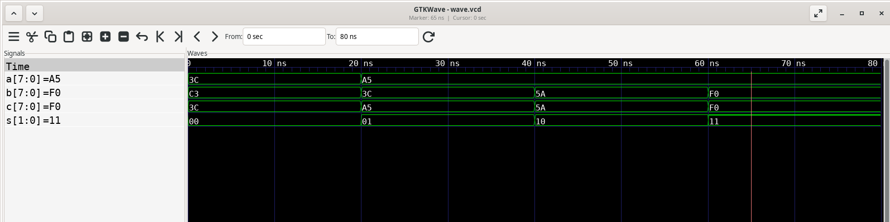
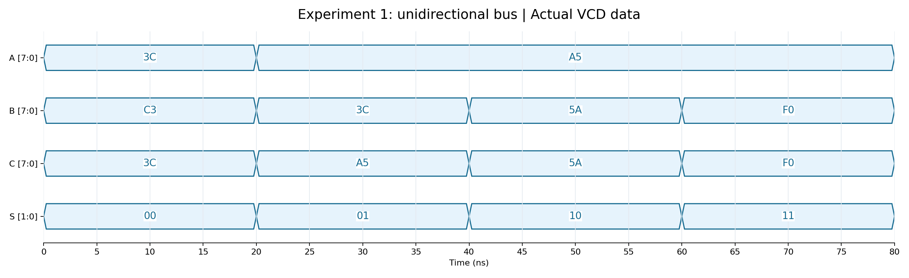
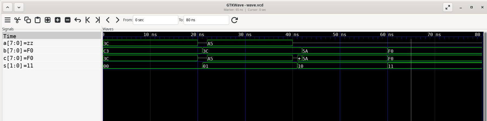
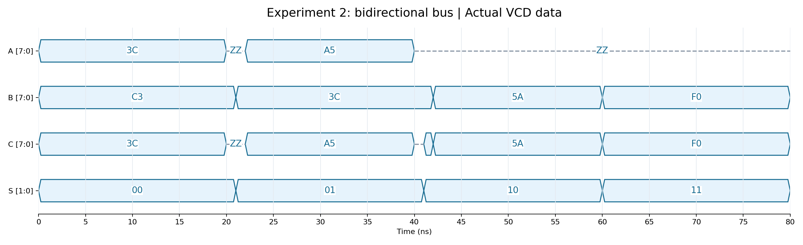

# 8 位数据总线功能仿真实验

## 实验目标

分别设计并仿真单向总线和双向总线，验证控制信号 S 的四种状态下的数据传输。每组仅进行四项数据传输测试，时间范围均为 0–80 ns，波形由上到下只显示 A、B、C、S。

## 设计与测试方案

第一组 `bus_trans_unidirectional.vhd`：A、B 为 8 位输入，C 为 8 位输出；S=00/01 时 A→C，S=10/11 时 B→C。

第二组 `bus_trans.vhd`：A、C 为 8 位双向端口，B 为 8 位输入；S=00 时 C→A，S=01 时 A→C，S=10/11 时 B→C。保留原来的传输逻辑，仅精简代码格式并删除注释。

| 名义区间 | S | 第一组输入 → 预期输出 | 第二组输入 → 预期输出 |
| --- | --- | --- | --- |
| 0–20 ns | 00 | A=3C → C=3C | C=3C → A=3C |
| 20–40 ns | 01 | A=A5 → C=A5 | A=A5 → C=A5 |
| 40–60 ns | 10 | B=5A → C=5A | B=5A → C=5A |
| 60–80 ns | 11 | B=F0 → C=F0 | B=F0 → C=F0 |

两个独立 Testbench 均在 5、25、45、65 ns 断言检查输出。双向总线在 20 ns 释放外部驱动，21 ns 切换 S，22 ns 设置 A；40 ns 释放 A，41 ns 切换 S，42 ns 设置 B。这些交接间隔保证数据稳定后再检查，不安排独立的高阻态或冲突测试。双向端口未被驱动时自然显示 ZZ，内部驱动信号不导出到 VCD、不加入图中。

## 实际结果与波形

以下表格直接从本次 GHDL 生成的 VCD 中采样，PASS 同时要求 GHDL 正常退出、对应 VHDL 断言通过、VCD 采样与预期一致。A/B/C 为 8 位十六进制，S 为二进制。

### 第一组：单向总线

| 采样/ns | A | B | C | S | 方向 | 预期输出 | 实际输出 | 结果 |
| --- | --- | --- | --- | --- | --- | --- | --- | --- |
| 5 | 3C | C3 | 3C | 00 | A->C | 3C | 3C | PASS |
| 25 | A5 | 3C | A5 | 01 | A->C | A5 | A5 | PASS |
| 45 | A5 | 5A | 5A | 10 | B->C | 5A | 5A | PASS |
| 65 | A5 | F0 | F0 | 11 | B->C | F0 | F0 | PASS |

GTKWave 真实窗口截图：



真实 VCD 的 Python 渲染图：



### 第二组：双向总线

| 采样/ns | A | B | C | S | 方向 | 预期输出 | 实际输出 | 结果 |
| --- | --- | --- | --- | --- | --- | --- | --- | --- |
| 5 | 3C | C3 | 3C | 00 | C->A | 3C | 3C | PASS |
| 25 | A5 | 3C | A5 | 01 | A->C | A5 | A5 | PASS |
| 45 | ZZ | 5A | 5A | 10 | B->C | 5A | 5A | PASS |
| 65 | ZZ | F0 | F0 | 11 | B->C | F0 | F0 | PASS |

GTKWave 真实窗口截图：



真实 VCD 的 Python 渲染图：



## 结论与复现

两组均完成 GHDL 分析、展开及 0–80 ns 仿真，每组四项数据传输断言全部 PASS，合计 8/8；对应 VCD 采样也全部通过。VCD 和两种波形图片均只包含 A、B、C、S。原双向总线在实验要求的四种合法选择状态下无需逻辑修复。

在仓库根目录执行：

```bash
./scripts/run_sim.sh
python3 scripts/capture_gtkwave.py
```

每组结果分别保存在 `unidirectional/` 和 `bidirectional/`：`simulation.log` 记录实际命令和断言输出，`wave.vcd` 保留实际事件，`results.csv` 记录采样值，`wave.gtkw` 保存 ABCS 视图，`gtkwave.log` 记录 GUI 载入，`waveform_screenshot.png` 是实际 GTKWave 截图，`waveform_rendered.png` 是 Python 解析 VCD 绘制的时序图。工具版本与安装方法见 `tool_setup.log`。
